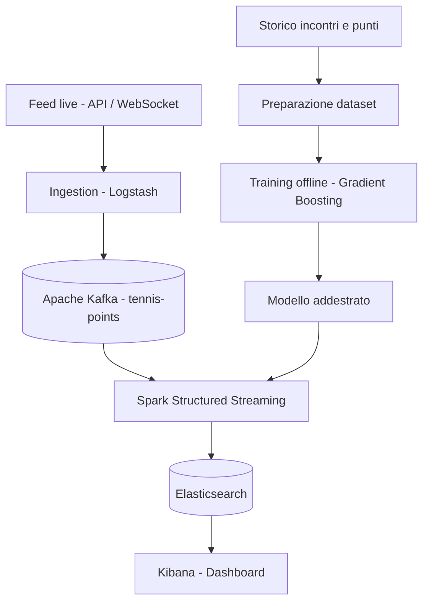

# data-set-match

Sistema di analisi e previsione in tempo reale degli incontri di tennis, sviluppato come progetto per l'esame di **TAP** del corso di laurea in Informatica dell'Università di Catania.

## Obiettivo

Il progetto integra **stream processing** e **machine learning** per analizzare in tempo reale gli eventi punto per punto di una partita di tennis. L'obiettivo è stimare e aggiornare continuamente la **probabilità di vittoria del match** per ciascun giocatore, sfruttando i dati storici, le statistiche di gioco e le **previsioni sull'esito del punto successivo**.

## Architettura prevista



L'addestramento viene eseguito **offline** su dati storici. Durante l'esecuzione della pipeline, il sistema utilizza il modello già addestrato per produrre le previsioni sui nuovi eventi.

## Dataset e feature

Il dataset di training è costruito a livello di **singolo punto**: ogni riga descrive la situazione nota *prima* del punto da prevedere.

Esempi di informazioni considerate:

| Categoria | Esempi |
| --- | --- |
| Incontro | `match_id`, `player1_id`, `player2_id` |
| Servizio | `server_id`, `receiver_id` |
| Stato del match | `set_number`, `game_number`, `score` |
| Contesto del punto | `is_break_point`, `is_game_point`, `is_set_point` |
| Statistiche storiche | rendimento al servizio e in risposta, calcolato sui dati precedenti all'incontro |
| Statistiche live | statistiche aggregate sui soli punti già disputati |
| Target | vincitore del punto successivo |

**Prevenzione del data leakage:** le feature non devono contenere informazioni sul punto da prevedere o su eventi futuri. Anche la validazione del modello dovrà separare gli incontri di training e test, preferibilmente in ordine temporale.

## Machine Learning

- **Problema:** classificazione binaria con stima della probabilità di vittoria del prossimo punto.
- **Approccio previsto:** Gradient Boosting.
- **Training:** offline, a partire da dati storici normalizzati.
- **Inferenza:** nella pipeline di streaming, utilizzando il modello precedentemente addestrato.
- **Valutazione prevista:** log loss, Brier score e metriche di classificazione, con attenzione alla calibrazione delle probabilità.

## Stack tecnologico

| Componente | Tecnologia |
| --- | --- |
| Acquisizione dati | Tennis API / WebSocket, Logstash |
| Message broker | Apache Kafka |
| Elaborazione streaming | Apache Spark Structured Streaming |
| Machine Learning | Apache Spark ML (MLlib), PySpark, Gradient-Boosted Trees |
| Indicizzazione e ricerca | Elasticsearch |
| Visualizzazione | Kibana |
| Orchestrazione locale | Docker Compose |

## Organizzazione del repository

La struttura verrà popolata progressivamente durante lo sviluppo:

```text
.
├── data/                 # Dataset locali
├── training/             # Preparazione dati e training offline
├── ingestion/            # Acquisizione e pubblicazione degli eventi
├── streaming/            # Elaborazione e inferenza in tempo reale
├── config/               # Configurazioni dei servizi
├── notebooks/            # Analisi ed esperimenti
├── docker-compose.yml    # Ambiente containerizzato 
└── README.md
```

I dettagli di configurazione, avvio e riproducibilità degli esperimenti saranno documentati man mano che le componenti saranno implementate.

## Origine e utilizzo dei dati

Per la preparazione del dataset si prevede di usare dati storici di tennis acquisiti tramite **Tennis API**.

Le **chiavi API**, i file `.env`, i dataset soggetti a restrizioni e gli altri segreti non devono essere pubblicati nel repository. Le condizioni di utilizzo e ridistribuzione dei dati di terze parti restano distinte dalla licenza del codice.

## Licenza

Il **codice originale** del progetto è distribuito con licenza [MIT](LICENSE). La licenza non si estende automaticamente a dati, servizi e risorse di terze parti.
