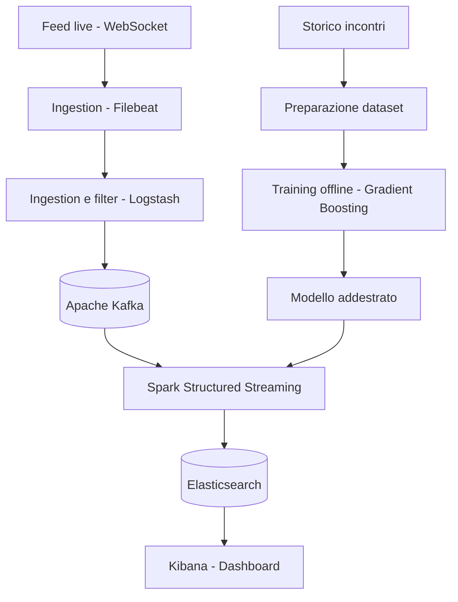

# data-set-match

Sistema di analisi e previsione in tempo reale degli incontri di tennis, sviluppato come progetto per l'esame di **TAP** del corso di laurea in Informatica dell'Università di Catania.

## Obiettivo

Il progetto integra **stream processing** e **machine learning** per analizzare in tempo reale gli eventi punto per punto di una partita di tennis. L'obiettivo è stimare e aggiornare continuamente la **probabilità di vittoria del match** per ciascun giocatore.

## Architettura prevista


## Mockoon o simili

Per testare la demo quando non ci sono match `Masters 1000` e `Grand Slam` è possibile usare [Mockoon](https://github.com/mockoon/mockoon).
In `ingestion/data/ws` troviamo i frames di partite passate e il file file di configurazione `ws.json`.

## Avvio rapido

```bash
.venv/bin/python -m pip install -r training/requirements.txt
.venv/bin/python -m training.fetch_matches
.venv/bin/python -m training.fetch_players
.venv/bin/python -m training.prepare_dataset

docker compose run --rm --build spark-ml

#Simulazione WS con mockoon

docker compose up --build -d filebeat spark-streaming kibana

```

## Dataset

Il dataset di training è costruito per **singolo punto**.

Esempio di una riga di dataset:

| Nome | Valore | Breve descrizione |
|---|---|---|
| match_id | 12106804 | Identificativo dell’incontro. |
| match_date | 2026-03-05 | Data dell’incontro. |
| player_a_id | 13091 | Identificativo del giocatore A. |
| player_b_id | 2384 | Identificativo del giocatore B. |
| best_of | 3 | Numero massimo di set |
| surface | Hard | Superficie del campo |
| player_a_rank | 63 | Ranking di A nella stagione precedente. |
| player_b_rank | 44 | Ranking di B nella stagione precedente. |
| player_a_rank_missing | 0 | Ranking di A disponibile; 1 indica dato mancante. |
| player_b_rank_missing | 0 | Ranking di B disponibile; 1 indica dato mancante. |
| label | 0 | Target: 1 indica vittoria di A. |
| point_index | 0 | Indice dello snapshot: 0 indica lo stato iniziale. |
| sets_a | 0 | Set vinti da A nello snapshot. |
| sets_b | 0 | Set vinti da B nello snapshot. |
| games_a | 0 | Game vinti da A nel set corrente. |
| games_b | 0 | Game vinti da B nel set corrente. |
| regular_score_a | 0 | Punti di A codificati: 0→0, 15→1, 30→2, 40→3, A→4. |
| regular_score_b | 0 | Punti di B con la stessa codifica. |
| is_tiebreak | 0 | Game regolare; 1 indica un tie-break. |
| tiebreak_target | 0 | Soglia del tie-break: 7 o 10; 0 fuori dal tie-break. |
| tiebreak_score_a | 0 | Punti di A nel tie-break; 0 nei game regolari. |
| tiebreak_score_b | 0 | Punti di B nel tie-break; 0 nei game regolari. |
| player_a_is_serving | 1 | Serve A; 0 indica che serve B. |
| sample_weight | 0.005555555555555556 | Peso della riga |

## Preparare il dataset

1. Dalla `root` del progetto installare tutte le dipendenze

```bash
.venv/bin/python -m pip install -r training/requirements.txt
```

2. `fetch_matches` scarica i match, nella nostra demo stiamo considerando solo match di Grand Slam e Masters 1000 relativi agli anni 2024, 2025, 2026.

```bash
.venv/bin/python -m training.fetch_matches
```

3. `fetch_players` scarica i dati relativi ai giocatori presenti nei match trovati.

```bash
.venv/bin/python -m training.fetch_players
```

4. `prepare_dataset` crea i file parquet per l'addestramento del modello, li divide in `train.parquet`, `validation.parquet` e `test.parquet`.

```bash
.venv/bin/python -m training.prepare_dataset
```

## Training

L'addestramento viene eseguito **offline** su dati storici. Durante l'esecuzione della pipeline, il sistema utilizza il modello già addestrato per produrre le previsioni sui nuovi eventi.
Il modello utilizzato è `GBTClassifier` con 17 feature.

- `best_of`, `surface`.
- `player_a_rank`, `player_b_rank`, `player_a_rank_missing`, `player_b_rank_missing`.
- `sets_a`, `sets_b`, `games_a`, `games_b`.
- `regular_score_a`, `regular_score_b`.
- `is_tiebreak`, `tiebreak_target`, `tiebreak_score_a`, `tiebreak_score_b`.
- `player_a_is_serving`.

**Prevenzione del data leakage:** le feature non contengono informazioni sul punto da prevedere o su eventi futuri.

## Addestramento del modello e valutazione

```bash
docker compose up --build spark-ml
```

Il training addestra due candidati sul 2024: uno con gli iperparametri
attuali e uno con i default di Spark. Mostra le quattro metriche sul 2025
e sceglie la configurazione con log loss pesata minore. Riaddestra poi il modello
da zero su 2024 e 2025, vengono stampate le metriche calcolate sul test 2026
e infine viene salvato il modello.

## Ingestion

Filebeat riceve il WebSocket di API Tennis, interpreta il JSON e invia
un evento per match a Logstash tramite il protocollo Beats. Logstash
aggiunge l'identificativo dell'incontro e inoltra l'evento a Kafka.

Il blocco `filter` di Logstash conserva soltanto gli incontri `Atp Singles`, quattro Slam
e nove Masters 1000.

## Run del blocco Ingestion

```bash
docker compose up --build filebeat
```

`filebeat` dipende da `logstash` che a sua volta dipende da `kafka-init` che infine dipende da `kafka`.

1. `kafka.init` attende l'avvio del motore `kafka` e crea, se non esiste già, il topic `tennis-points`

2. `filebeat` prende in input la websocket, l'`URL` viene passata da `.env`, se il valore è vuoto viene
selezionata quella di `API-tennis` di default, infine manda il contenuto JSON in output a `logstash`.

3. `logstash` prende in input il JSON da `filebeat`, usa `filter` per filtrare i match che non sono
`ATP Single` e che non rientrano in Masters 1000 e Grand Slam.

Il programma `program` in `filebeat.yml` usa CEL: decodifica ogni messaggio JSON, trasforma un oggetto 
singolo in una lista di un elemento e pubblica un evento per ogni match nel campo `match`.

Filebeat aggiunge `@timestamp` rappresenta l'istante di acquisizione, non l'orario del punto.
Logstash usa `match_id` come chiave Kafka e una sola pipeline worker, con elaborazione ordinata.

## Kafka

`kafka` conserva gli eventi nel topic `tennis-points`, configurato con una sola partizione.

Su `kafka` possiamo controllare che i messaggi da `logstash` arrivino correttamente, da terminale
lanciamo il comando:

```bash
docker compose exec kafka /opt/kafka/bin/kafka-console-consumer.sh --bootstrap-server kafka:9092 --topic "tennis-points" --formatter-property print.key=true --from-beginning
```

`kafka` identifica ogni messaggio tramite `partizione` e `offset`, consentendone la rilettura dopo un’interruzione.

## Previsione live del vincitore del match

`Spark structured streaming` è un API `Spark` che ci permette di fare operazioni sui `micro-batch` prodotti.

## Flusso di un micro-batch

```bash
    docker compose up --build spark-streaming
```

All’avvio Spark carica il modello, la configurazione dei tornei e i profili dei giocatori,
dai quali ricava i ranking per stagione.

1. Spark legge i messaggi da Kafka, mantenendo chiave, partizione, offset
   e timestamp. Interpreta il JSON con uno schema esplicito e aggiunge
   `parse_ok` per indicare se il parsing è riuscito e l’ID è presente.

2. `foreachBatch` passa il micro-batch a `process_batch()`, che separa gli
   incontri con stato `Finished` dagli aggiornamenti in corso. Per questi
   ultimi mantiene gli eventi con parsing valido, stato da `Set 1` a
   `Set 5`.

3. `build_snapshot_features()` ricava il punteggio dello snapshot:
   set da `event_final_result`, game dall’ultimo elemento di `scores`,
   punti da `event_game_result` e battitore da `event_serve`.

4. Tramite join tra DataFrame aggiunge la superficie del torneo e i
   ranking dei giocatori relativi alla stagione precedente al match.
   I ranking mancanti vengono sostituiti con zero e segnalati tramite
   apposite feature.

5. Le righe con valori nulli nelle 17 feature richieste vengono scartate.
   Il DataFrame risultante viene passato a `PipelineModel.transform()`
   per calcolare le probabilità di vittoria.

6. Le previsioni vengono unite agli eventi `Finished`. Per gli incontri
   conclusi le probabilità vengono impostate a 1 per il vincitore e 0
   per lo sconfitto, usando `event_winner`, senza eseguire il modello
   su questi eventi.

7. Una `select` prepara l’output con giocatori, torneo, stato, punteggio,
   probabilità, timestamp, partizione e offset. I campi del punteggio
   destinati alla visualizzazione vengono mantenuti separati dalla
   codifica usata dal modello.

8. `write_predictions()` aggiunge `document_id`, `kafka_topic` e
   `batch_id`, quindi scrive su Elasticsearch tramite
   `.write.format("es")`. L’ID del documento è composto da
   topic, partizione e offset.

9. Quando `process_batch()` termina correttamente, Spark registra il
   completamento del micro-batch nel checkpoint persistente.
   Il trigger è configurato con un intervallo di 5 secondi.

Spark Structured Streaming salva gli offset Kafka e l’avanzamento
dei micro-batch nel checkpoint `/app/checkpoints/kafka-reader`,
conservato nel volume Docker `streaming-checkpoints`. In caso di interruzione,
usa queste informazioni per riprendere l’elaborazione, purché i messaggi
necessari siano ancora disponibili in Kafka.

## Scrittura su Elasticsearch

Spark 4.2.0 usa il connettore `elasticsearch-spark-41_2.13:9.6.0-SNAPSHOT`,
scaricato dal repository ufficiale Elastic durante la build Docker e caricato
con `--jars`.

Compose avvia Elasticsearch come cluster di un solo nodo (`es01`), con volume
persistente e porta pubblicata su `127.0.0.1:9200`.

Vengono salvati gli aggiornamenti in corso che superano i filtri e contengono 
tutte le feature richieste, oltre agli eventi con stato Finished. 
Ogni riga di output diventa un documento Elasticsearch contenente topic, 
partizione e offset dell’evento Kafka originale e ID del batch.

L’ID document_id=topic:partizione:offset permette al connettore di sovrascrivere 
lo stesso documento se un batch viene rieseguito. I campi null vengono conservati.

Due aggiornamenti identici ricevuti con offset Kafka diversi producono documenti distinti: 
l’ID protegge dalla ripetizione della scrittura, ma non elimina gli snapshot ripetuti dalla sorgente.

Per controllare lo stato del cluser, contare i documenti presenti nell'indice e visualizzarne i primi tre:

```bash
curl -s 'http://localhost:9200/_cluster/health?pretty'
curl -s 'http://localhost:9200/tennis-predictions/_count?pretty'
curl -s 'http://localhost:9200/tennis-predictions/_search?size=3&sort=timestamp:desc&pretty'
```

## Visualization

`kibana`, raggiungibile su `localhost:5601`, permette di visualizzare
le previsioni salvate su Elasticsearch attraverso una dashboard. Nella directory `visualization` c'è un export della
dashboard creata.

La directory `visualization` contiene l’export `general_dashboard.njson`,
da importare manualmente in Kibana. Nell’ambiente di destinazione deve
essere disponibile anche la vista dati utilizzata dalla dashboard,
collegata all’indice `tennis-predictions`.

## Licenza

Il **codice originale** del progetto è distribuito con licenza [MIT](LICENSE). La licenza non si estende automaticamente a dati, servizi e risorse di terze parti.